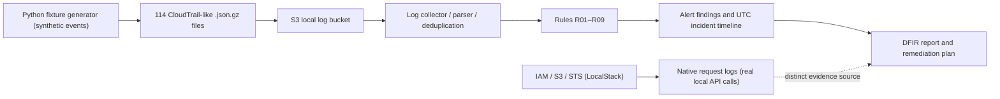

# AWS CloudTrail — Cloud Security & DFIR Investigation Lab

**Cloud security | IAM/S3 | Detection engineering | Digital forensics | Incident response | Python**

A reproducible educational investigation of suspicious AWS-style activity. This project combines **real requests to locally emulated AWS services** with a **synthetic CloudTrail-format dataset** and a Python rule-based detection pipeline.

> **Evidence boundary:** No real AWS account or real CloudTrail service was used. LocalStack Community 4.14 emulates S3, IAM and STS. The 265 CloudTrail-style records are synthetic. Native LocalStack API logs and synthetic CloudTrail events are different evidence sources.

[Documentation française](docs/README.fr.md) · [Architecture](docs/ARCHITECTURE.md) · [Installation](docs/SETUP.md) · [Detection rules](docs/DETECTION_RULES.md) · [Investigation](docs/INCIDENT_WALKTHROUGH.md) · [Results](docs/RESULTS.md) · [Troubleshooting](docs/TROUBLESHOOTING.md) · [Source attribution](docs/SOURCE_ATTRIBUTION.md)

## Project objectives

- Understand S3, IAM, STS and deliberately excessive IAM permissions.
- Execute sample IAM/S3 operations against an isolated LocalStack emulator.
- Create and store reproducible **CloudTrail-like JSON events** in S3.
- Collect logs, parse them and deduplicate by `eventID`.
- Apply **9 detection rules (R01–R09)** and investigate 6 scenarios (S1–S6).
- Preserve an evidence-linked UTC chronology and recommend containment measures.

## Verified lab results

| Metric | Result |
|---|---:|
| Synthetic events | **265** (247 background/decoy + 18 attack/response) |
| Compressed S3 log files | **114** |
| Detection rules | **9** |
| Critical / High / Medium / Low / Info alerts | **9 / 2 / 2 / 6 / 1** |
| Total findings at 30-minute silence threshold | **20** |
| Synthetic logging interruption | **~71 minutes** |
| Python unit tests | **6 passed** |

**20 alerts do not mean 20 separate attacks.** Multiple rules may flag related actions.

## How the pipeline works



The chosen illustrated architecture is provided separately in the ready-to-upload project package as `assets/cloudtrail-architecture.png`.

## The simulated attack: 2026-10-29 UTC

| Time | Event | Investigative meaning |
|---|---|---|
| 02:11–02:14 | Failed logins then `ConsoleLogin` success without MFA | Suspected compromise of Bob |
| 02:16–02:18 | Four denied IAM/S3 operations | Reconnaissance |
| 02:21:40 | `AttachUserPolicy` with AdministratorAccess | Privilege escalation |
| 02:23:15 | `CreateAccessKey` for `svc-backup` | Persistence |
| 02:26:48 | New access key used | Credential use |
| 02:33:05 | `DeleteBucket` `corp-backups-prod` | Backup deletion |
| 02:39–02:41 | `DeleteTrail` denied; `StopLogging` succeeded in synthetic logs | Impaired logging |
| 03:52:10 | `StartLogging` by Alice | Logging restored |

**Important:** the live LocalStack `StopLogging` request fails because CloudTrail is not emulated. The successful `StopLogging` listed above appears in **synthetic evidence only**.

## Quick start

The full runnable lab requires the Python sources, scripts and synthetic fixture files included in the **complete project ZIP** (see release/import instructions). Once those files are present:

```bash
cp .env.example .env
docker compose up -d --build
docker compose ps
docker compose exec lab bash
# Inside 'lab':
bash scripts/00_check_env.sh
bash scripts/01_init_aws_local.sh
aws s3 ls
bash scripts/02_generate_activity.sh     # LocalStack only, modifies emulated resources
bash scripts/01_init_aws_local.sh        # Restores removed sample bucket
python src/generate_events.py
bash scripts/03_upload_logs.sh
bash scripts/04_collect_and_analyze.sh
cat reports/analysis_report.md
```

For environments where DNS fails *during the Docker build only*, see [Troubleshooting](docs/TROUBLESHOOTING.md) for the optional host-build-network overlay. There is no need for real AWS keys or a credit card.

## Repository sections

- `src/`: synthetic event generation, log parsing and detection engine
- `scripts/`: environment check, local S3/IAM initialization, simulation and analysis
- `config/`: intentionally over-permissive **lab-only** IAM example
- `data/`: synthetic JSON fixtures and generated compressed CloudTrail-like logs
- `docs/`: architecture, investigation, operational guide, screenshots and limitations
- `examples/`: sample findings and incident timeline
- `tests/`: six Python unit tests
- `.github/workflows/`: automated Python and Bash checks

## Scope and integrity

Only execute the intentionally vulnerable IAM examples against the emulator. Never use them in production. Credentials in `.env`, actual tokens, instructor answer keys and transient local evidence are excluded.

This project is based on academic starter materials for an EMSI practical assignment supervised by **Pr. JAADOUNI Hatim**. The original starter source was not accompanied by an explicit redistribution license. See [attribution and publication notes](docs/SOURCE_ATTRIBUTION.md); independently authored analysis should not be mistaken for authorship of all starter scripts.

**Portfolio focus:** Blue Team · Detection Engineering · Cloud Security · DFIR · AWS IAM/S3 · Python · Docker.
