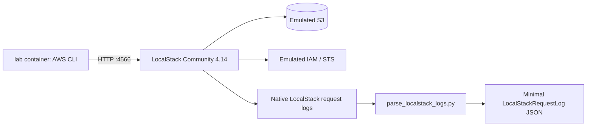
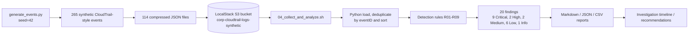

# Architecture — implementation versus evidence

The distinction below is critical: **LocalStack API request logs and synthetic CloudTrail-like records come from different sources.** The synthetic events are not emitted by the LocalStack API actions.

## 1. Actual local API execution

The `02_generate_activity.sh` script executes operations against the emulator. In the observed run, the native logs included successful `iam.AttachUserPolicy`, `iam.CreateAccessKey`, and `s3.DeleteBucket` requests, but `cloudtrail.StopLogging` returned an unsupported-service error.

## 2. Synthetic CloudTrail-format detection pipeline

## CloudTrail-style fields used

| Field | Analysis purpose |
| --- | --- |
| `eventTime` | UTC chronology |
| `userIdentity` | actor and access key |
| `eventName` and `eventSource` | API action and service |
| `sourceIPAddress` | source correlation and out-of-perimeter detection |
| `errorCode` and `responseElements` | operation result and access denials |
| `requestParameters` | targeted resource or user |
| `eventID` | traceable evidence identifier |

## Network boundary

Docker Compose connects `lab` to LocalStack by the hostname `localstack` over port `4566`. LocalStack publishes `127.0.0.1:4566`, avoiding unnecessary exposure to a local LAN. The optional DNS troubleshooting overlay changes **build networking only**, not runtime networking.

See [the original selected visual](../assets/cloudtrail-architecture.png). It is a conceptual overview; the Mermaid diagrams above show the actual source-of-evidence separation more explicitly.
