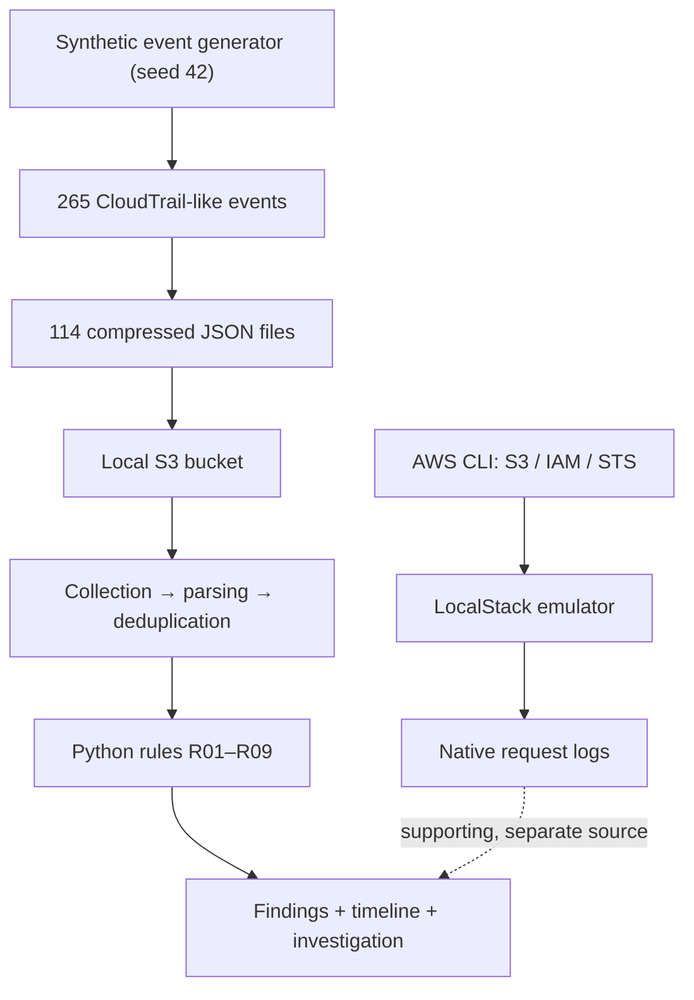

# Architecture et flux de données

## Deux sources de données distinctes

**Source 1 — Requêtes natives LocalStack.** Le conteneur `lab` envoie via AWS CLI des requêtes HTTP vers `http://localstack:4566`. LocalStack Community 4.14 émule S3, IAM et STS. Les journaux du serveur montrent des opérations et leurs codes HTTP (200, 204, 404, 501). Ce ne sont **pas** des événements CloudTrail.

**Source 2 — Dataset CloudTrail synthétique.** `src/generate_events.py` produit un jeu déterministe de 265 enregistrements (247 bruit/leurres et 18 événements d'attaque/réponse), répartis dans 114 fichiers JSON gzip au format `AWSLogs/<account>/CloudTrail/<region>/YYYY/MM/DD/`.

## Services and logical assets

- `corp-app-data`: application objects.
- `corp-backups-prod`: sample production backups.
- `corp-finance-secrets`: simulated sensitive financial records.
- `corp-cloudtrail-logs-synthetic`: synthetic evidence objects.
- Users: `alice`, `bob`, `carol`, `svc-backup`.
- `DevPolicy`: intentionally over-permissive `iam:AttachUserPolicy`, `iam:CreateAccessKey` and S3 actions.

## Host vs analysis container

Run `docker compose ...` on the Docker host. Run `aws`, `jq`, `python` and `bash scripts/*.sh` **inside `lab`**, where the local endpoint and dummy credentials are set.

The Compose port binding `127.0.0.1:4566:4566` limits external exposure. The `lab` container reaches the emulator by Docker DNS via the hostname `localstack`.

## Limitations

No real AWS tenant, no real CloudTrail service, no complete IAM enforcement in LocalStack Community, no proof of what happened during the synthetic logging gap. The architecture image is a presentation aid; the scripts and trace files define the actual observed behavior.
